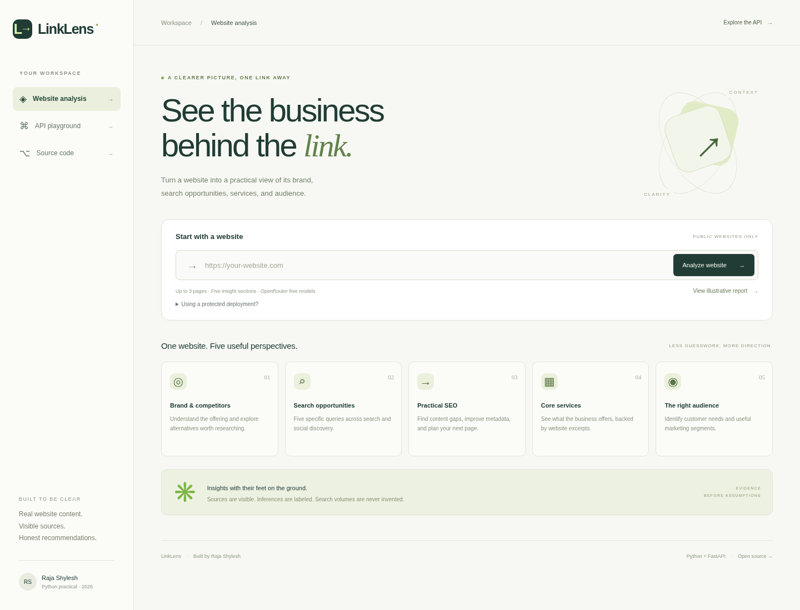
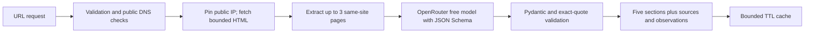

# LinkLens · AI-powered website link analysis

[](https://github.com/RajaShylesh112/dxora-link-analysis/actions)

**One website, five evidence-led perspectives.** A Python/FastAPI API that fetches public website content, extracts readable text, uses **OpenRouter free models**, validates the analysis, and returns brand/competitor, search, SEO, service and audience insights. Includes a responsive reviewer interface, source excerpts, actual HTML observations and downloadable JSON.



## Run locally

Python **3.11–3.13** supported; Python 3.12 recommended.

```bash
git clone https://github.com/RajaShylesh112/dxora-link-analysis.git
cd dxora-link-analysis
python -m venv .venv
source .venv/bin/activate
# Windows PowerShell: .venv\Scripts\Activate.ps1
pip install -r requirements.txt
cp .env.example .env
# Set OPENROUTER_API_KEY in .env (never commit it)
uvicorn app.main:app --host 0.0.0.0 --port 4000 --no-proxy-headers
```

- **Reviewer interface:** http://localhost:4000
- **Interactive API docs:** http://localhost:4000/docs
- **API:** `POST http://localhost:4000/link-analysis`
- **Readiness information:** `GET /health` (`analysis_configured` reports key presence, not provider validity)

Get your own key from [OpenRouter](https://openrouter.ai/settings/keys). The default model is `openrouter/free`. Only the free router or model IDs ending in `:free` are accepted, and provider routing caps input/output prices at zero. There is no paid fallback. A key is still required for free models, and account/availability limits apply.

**Verification status:** [94 automated tests](docs/evidence/tests.log) and [Chromium UI checks](docs/evidence/browser-check.json) validate the local implementation. Fixtures intercept website and LLM traffic; these are not live-model benchmarks. The illustrative UI report is explicitly labeled and never used by the analysis endpoint. Real analysis requires a configured OpenRouter key and public outbound HTTPS access. Deployment and live model evidence must be recorded before describing a demo as live; see [deployment instructions](docs/deployment.md).

## API request and response

```bash
curl -i http://localhost:4000/link-analysis \
  -H 'Content-Type: application/json' \
  -d '{"url":"https://basecamp.com"}'
```

The request contains **exactly one `url` field**. Only absolute HTTP(S) URLs on their standard ports are accepted. Credentials in URLs, internal names, private/non-public IPs, ambiguous numeric IP forms, unsafe DNS answers and unsafe redirects are rejected.

Response structure (shape only; full values are generated from the submitted website):

```json
{
  "success": true,
  "website": "https://your-public-website.com/",
  "brand": {
    "name": "...",
    "category": "...",
    "summary": "...",
    "products_and_services": ["..."],
    "evidence": [{"source_id": "S1", "quote": "Exact text from captured content"}]
  },
  "analysis": {
    "competitor_analysis": {"brand_overview": "...", "competitors": [], "strengths": [], "opportunities": [], "limitations": "..."},
    "target_search_queries": ["Five typed query objects; see full example"],
    "seo_improvements": {"primary_keyword": "...", "secondary_keywords": [], "long_tail_keywords": [], "business_keywords": [], "recommended_title": "...", "title_rationale": "...", "meta_description": "...", "supporting_content": [], "priority_actions": []},
    "top_services": ["One to five typed service objects; see full example"],
    "target_audience": {"primary_audience": [], "secondary_audience": [], "industries": [], "business_types": [], "customer_profiles": [], "geographical_focus": null, "geographical_evidence": [], "customer_needs": [], "interests": [], "marketing_segments": [], "inference_notes": "..."}
  },
  "sources": ["Captured page metadata and text"],
  "seo_observations": ["Measured HTML observations"],
  "metadata": {"provider": "OpenRouter", "model_used": "Actual model ID", "cached": false, "usage": "Actual provider usage if supplied", "warnings": []}
}
```

The schematic above is **not a schema-valid sample**; it abbreviates nested objects for readability. A complete schema-valid [illustrative response](app/static/sample-report.json), a [captured offline pipeline response](docs/evidence/offline-pipeline-response.json), and the [OpenAPI schema](docs/openapi.json) are included. Fictional `northstar.example` data is a test fixture, not a successfully analyzed public website.

Every successful response includes:

| Section | Content and safeguards |
|---|---|
| Brand & competitors | Brand name, category, overview, offerings and exact source quotes. Three competitor suggestions where the model can responsibly identify them; all comparisons are explicitly **unverified AI suggestions**. Fewer are allowed when uncertainty makes three unreliable. |
| Five target queries | Exactly five distinct queries, collectively covering **Google, Facebook, Instagram, LinkedIn and X**, with intent, relevance and audience. No search-volume field exists. |
| SEO | Primary, secondary, long-tail and business keywords; a title and meta description; supporting-page ideas and priority actions. HTML title/meta/H1/image-alt/canonical checks are measured separately from AI suggestions. |
| Top services | Up to five actual products/services with exact quotes. Additional inferred recommendations must be labeled and explained. Returns fewer rather than inventing services. |
| Target audience | Primary/secondary audiences, industries, business types, profiles, needs, interests and marketing segments. Geography is null unless supported by matching source quotes. |

Source IDs link claims to text captured during the request. Exact-quote validation checks provenance, **not full semantic truth**: a matching quotation does not prove every interpretation is correct. Audience and benefit deductions are recommendations. Competitor websites are not crawled; independently researched competitor facts are outside this two-hour implementation.

### Errors

```json
{
  "success": false,
  "error": {
    "code": "llm_not_configured",
    "message": "Configure OPENROUTER_API_KEY to enable live analysis",
    "request_id": "request identifier"
  }
}
```

| HTTP | Examples |
|---|---|
| 401 | Optional deployment API key missing/incorrect |
| 413 | Request body exceeds 8 KB |
| 422 | Invalid/unsafe URL, blocked destination, inaccessible or non-HTML page, too little readable text |
| 429 | Local rate or concurrent analysis limit reached; `Retry-After: 60` |
| 502 | Unsupported provider request or invalid/incomplete/ungrounded model output |
| 503 | Missing/rejected LLM credentials, account restrictions, free-model limit or availability failure |
| 504 | Website, provider or total-analysis timeout |

Errors never expose provider response bodies, credentials or stack traces. `X-Request-ID` correlates responses with minimal server logs. No generic success report is returned on failure.

## Architecture



`app/main.py` handles HTTP/lifecycle; `schemas.py` defines contracts; `services/url_guard.py` guards destinations; `website_extractor.py` fetches and parses; `llm_service.py` constructs the prompt and validates provider output; `analysis_service.py` coordinates caching, concurrency and response metadata. The UI is plain HTML/CSS/JavaScript served by FastAPI, with no Node build required.

## Model comparison and recommendation

Research checked **18 November 2026**, from provider documentation and the public OpenRouter model catalog. Prices below are **USD per million tokens**, standard direct-provider text rates unless noted. **None of the speed/accuracy comparisons are benchmark results from this application.**

| Provider / model | Input / output | Context | JSON support | Speed & accuracy assessment | Suitability |
|---|---:|---:|---|---|---|
| OpenRouter `openrouter/free` | **$0 / $0** for the free model route | Varies; router catalog lists 200k | Feature-filtered routing; strict schema requested and validated locally | Availability and selected model vary. Accuracy/latency unmeasured. | **Selected for this zero-budget demo.** Record `model_used` for each response. |
| OpenAI `gpt-6-luna` | $0.10 / $0.50 | 1,050,000 | Structured outputs | Provider positions it for efficient high-volume work; app accuracy unmeasured. | Low-cost paid candidate for a later controlled evaluation. |
| Google `gemini-3.5-flash-lite` | $0.30 / $2.50; eligible free tier has quotas | 1,048,576 | Structured outputs | Provider describes low-latency extraction; app accuracy unmeasured. | Direct-provider alternative with explicit model selection. |
| Anthropic `claude-haiku-5-5` | $0.10 / $0.50 for prompts ≤100k; higher above 100k | 1M | Structured output support subject to API/model configuration | Provider describes latency-sensitive extraction; app accuracy unmeasured. | Paid candidate for comparing quote grounding and JSON validity. |

Sources: [OpenRouter free router](https://openrouter.ai/docs/guides/routing/routers/free-router), [OpenRouter structured output](https://openrouter.ai/docs/guides/features/structured-outputs), [OpenAI model/pricing](https://developers.openai.com/api/docs/models/gpt-6-luna), [Gemini pricing](https://aistudio.google.com/docs/pricing#gemini-3.5-flash-lite), [Gemini model](https://aistudio.google.com/docs/models/gemini-3.5-flash-lite), [Claude model/pricing](https://platform.claude.com/docs/en/models/haiku-5-5/overview). The saved [free-model catalog subset](docs/openrouter-free-models.json) captures actual catalog metadata as of the research date; it is not a promise of ongoing availability.

**Final recommendation for this submission:** OpenRouter with `openrouter/free`, strict JSON Schema and `require_parameters: true`. It meets the user's zero-cost requirement and filters routing to compatible free endpoints. Its random model selection limits reproducibility, so record the actual model ID. For a production decision, compare a pinned free model against the paid candidates on representative websites; do not claim a universal accuracy winner. Paid provider adapters are **researched alternatives, not implemented fallback integrations**.

**Fallback:** optionally set `OPENROUTER_FALLBACK_MODEL` to an explicit free model supporting structured outputs, selected from the live catalog. One alternate call is allowed for rate/availability/timeout/invalid-output failures; authentication failures are not retried. No fallback is configured by default. Model IDs may retire; refresh the catalog instead of assuming historical free names remain available.

**Estimated per analysis:** approximately 5,000–10,000 input tokens (including instructions/schema) and 2,500–5,000 output tokens. The 22,000-character content cap is **not** a token guarantee; non-English text/tokenizers vary. At a representative 8,000 input + 3,500 output tokens:

| Route/model | Estimated token charge |
|---|---:|
| OpenRouter free | $0.00000, subject to limits/availability |
| GPT-6 Luna | $0.00255 |
| Gemini 3.5 Flash-Lite paid | $0.01115 |
| Claude Haiku 5.5, ≤100k input | $0.00255 |

Formula: `(input_tokens × input_rate + output_tokens × output_rate) / 1,000,000`. Estimates exclude taxes, search/grounding tools and any extra billed reasoning tokens. Provider-reported usage and cost are returned when available; null means unavailable, not zero. Expected uncached latency is an **unmeasured planning estimate of 10–60 seconds**; free queues may exceed it and timeout. Render cold-start latency is additional. See [evaluation protocol](docs/evaluation.md) for how to produce real measurements.

Cost controls: remove script/style/navigation/footer/form content; deduplicate lines; cap pages, HTML and combined text; avoid sending the schema twice in strict mode; one normal model call; cache only fully validated successes for 15 minutes (64-entry LRU); coalesce simultaneous identical requests; bound concurrency; cap output at 6,500 tokens. Cached responses retain the **original generation's usage**, not new token charges.

## Tests, evidence and deployment

```bash
pip install -r requirements-dev.txt
ruff check app tests scripts
pytest -q
python -m scripts.build_fixture
# Optional UI verification (requires Node/Playwright only for browser tests):
npm install --no-save playwright
npx playwright install chromium
node scripts/browser_check.cjs
# Verify a real deployment; exits nonzero on any analysis failure:
python -m scripts.smoke --base-url https://YOUR-SERVICE.onrender.com \
  --website https://basecamp.com --out docs/evidence/live-analysis.json
```

[Evidence index](docs/evidence/README.md) explains what each log/screenshot proves. CI checks Python 3.11, 3.12 and 3.13. A [Dockerfile](Dockerfile) and [free Render Web Service instructions](docs/deployment.md) are included. No paid Blueprint or database is required.

## Security, limitations and honest scope

- DNS answers are all checked for global routability; actual website requests target a vetted **numeric IP** while preserving original `Host` and TLS SNI. Every redirect repeats validation/resolution. Ambiguous IP encodings, metadata/link-local/private/reserved/multicast/transition destinations are rejected.
- Website fetches use a direct HTTPX client without inherited proxies. Ordinary HTTP proxy tunnels do not reliably preserve pinned-IP SNI in HTTPX; the app fails closed instead of weakening checks. Deploy where direct public HTTP(S) egress works. The fixed OpenRouter API uses inherited HTTPS proxy settings normally.
- No TLS verification is disabled. Website cookies and authorization are never forwarded. URLs from canonical tags, image sources and model responses are not fetched.
- Limits: 8 KB request, 1.5 MB decompressed HTML/page, up to three pages, 22k combined text characters, four redirect hops, per-request deadlines and 200-second total analysis budget.
- Website content is treated as untrusted prompt data. Scripts/hidden HTML are removed, instructions are isolated, and output/evidence are validated. These controls reduce risk; they do not prove immunity to every prompt-injection attack.
- The UI uses `textContent`, not HTML insertion, for model/site output. A browser test checks malicious-looking model text remains inert. A same-origin CSP applies to the home page.
- Optional `ANALYSIS_API_KEY` protects analysis with `X-API-Key`; it is distinct from the server-side OpenRouter key. The UI holds it only in the current tab, never localStorage. Default public reviewer demos are rate-limited (6 requests/minute per ASGI peer) and limited to two active analyses. Behind a reverse proxy this may function as a shared limit. Use one worker for the included in-memory controls; configure trusted edge rate limiting before scaling.
- No raw website text, submitted URLs, prompts or keys are logged. Logs include only request ID, fixed outcome, cache flag and timing. Access logs may include endpoint paths. Public website text is sent to OpenRouter and its chosen provider; do not submit confidential URLs/content.
- Analysis uses server-rendered HTML, not a browser crawler. JavaScript-only pages, bot restrictions and login content can fail. Homepage plus selected about/service/product pages is a bounded sample, not a complete crawl or ranking audit.
- Cache and rate limits are in memory and reset on restart/Render sleep. Successful cached data can be up to the configured TTL old. Use TTL zero for uncached evaluation.
- Only OpenRouter is implemented; no search-volume/ranking API, paid grounded search, automated fact-checking of competitor claims, persistent database or background queue is included.

## Author

GitHub: [RajaShylesh112](https://github.com/RajaShylesh112). Repository ownership provides full collaborator access; no invitation to the same owner account is necessary.
